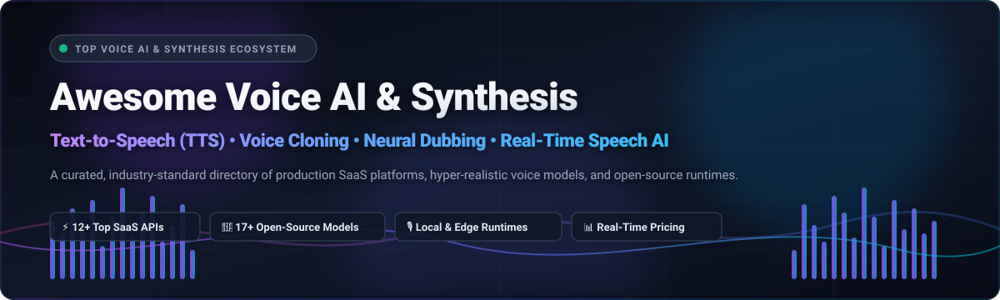
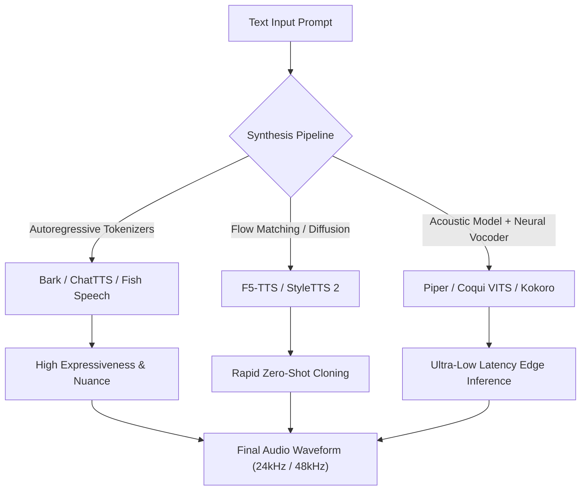

# Awesome Voice AI &amp; Synthesis 🎙️🔊

  

  
  
  
  
  
  

---

## 📖 Introduction &amp; Scope

Welcome to the definitive, SEO-optimized directory of **Voice AI &amp; Speech Synthesis** technologies 🌟. This repository curates the world's leading commercial SaaS platforms, proprietary neural speech engines, and groundbreaking open-source GitHub repositories dedicated to:

- 🗣️ **Text-to-Speech (TTS) &amp; Neural Audio Generation**
- 🧬 **Instant Zero-Shot Voice Cloning &amp; Speaker Adaptation**
- 🎬 **Neural Dubbing, Lip-Sync &amp; Localization Systems**
- 💬 **Ultra-Low Latency Conversational Voice Agents &amp; APIs**
- 🎧 **Offline, Edge &amp; Mobile On-Device Speech Synthesizers**

Whether you are building next-generation conversational AI bots, producing multilingual podcasts, generating voiceovers for gaming, or deploying local speech synthesis models on edge hardware, this guide delivers accurate pricing benchmarks, company valuations, and real-time open-source metrics.

---

## 📑 Table of Contents

- [📊 Sector Overview &amp; Market Dynamics](#-sector-overview--market-dynamics)
- [🏢 SaaS &amp; Commercial Voice AI Platforms](#-saas--commercial-voice-ai-platforms)
- [💻 Open-Source GitHub Repositories](#-open-source-github-repositories)
- [🛠️ Evaluation Criteria &amp; Architecture Taxonomy](#-evaluation-criteria--architecture-taxonomy)
- [🤝 How to Contribute](#-how-to-contribute)
- [💖 Support &amp; Sponsorship](#-support--sponsorship)
- [📈 Star History](#-star-history)
- [⚖️ Disclaimer &amp; Ethical AI Use](#-disclaimer--ethical-ai-use)

---

## 📊 Sector Overview &amp; Market Dynamics

The global **Text-to-Speech (TTS) and Speech Synthesis market** is valued at approximately **$4.1B to $4.6B** and is projected to expand to **$11.6B–$14.6B by the mid-2030s**, compounding at a robust **CAGR of ~12.5% to 13.5%** (with specialized Generative Voice AI, Voice Cloning, and AI Dubbing growing at an aggressive **~30% CAGR**).

The industry is **highly fragmented** rather than a winner-take-all monopoly:
- **Hyperscale Cloud Providers** (such as Microsoft Azure Speech, AWS Polly, Google Cloud Text-to-Speech) provide massive baseline infrastructure, enterprise compliance, and extensive global language libraries.
- **Specialized GenAI Innovators** (including ElevenLabs, Synthesia, Speechify, Murf AI, and Cartesia) compete aggressively on emotional prosody, human-grade inflection, low-latency streaming (<150ms), and fine-tuned creator tools.
- **Open-Source &amp; Edge Disruption** (such as F5-TTS, Kokoro, Piper, and Chatterbox) increasingly decentralizes synthesis, delivering competitive zero-shot voice cloning and fast offline inference directly on consumer GPUs and edge microprocessors.

---

## 🏢 SaaS &amp; Commercial Voice AI Platforms

Below is a comprehensive comparison of prominent commercial Voice AI, TTS, and Speech Synthesis platforms. Sorted in **descending order by company standing (valuation or annual revenue)** 📉.

| Platform 🚀 | Primary Capabilities &amp; Focus 🎯 | Company Standing (Valuation / Revenue) 💰 | Specific Starting Tier Pricing 🏷️ | Specific Free Tier / Trial Limits 🎁 |
| :--- | :--- | :--- | :--- | :--- |
| **[Synthesia](https://www.synthesia.io/)** | Enterprise AI video avatars, synthetic speech generation &amp; multilingual corporate dubbing | **$4.0B Valuation** ($200M Series E, ~$60M+ ARR) | **$29/month** (or $18/mo billed annually) for Starter plan | **Free-forever plan**: 10 minutes/month of video/audio generation with Synthesia watermark, 9 standard avatars, 36 min/year |
| **[ElevenLabs](https://elevenlabs.io/)** | Industry-leading generative neural TTS, voice cloning, dubbing studio &amp; conversational agent APIs | **$1.1B+ Valuation** ($80M Series B Unicorn, $80M+ ARR) | **$5/month** ($1 promo for 1st month; $6/mo standard) for Starter plan | **Free-forever plan**: 10,000 characters/month (~10 minutes of audio), 3 custom voices, API access (requires ElevenLabs attribution) |
| **[Descript](https://www.descript.com/)** | Text-based audio/video editing, AI Overdub voice cloning, Studio Sound &amp; podcasting suite | **$550M Valuation** (Series C led by OpenAI Startup Fund) | **$19/editor/month** ($16/mo billed annually) for Hobbyist plan | **Free-forever plan**: 1 media transcription hour/month, 100 AI credits, 720p watermark-free exports, 5GB storage |
| **[Deepgram (Aura)](https://deepgram.com/)** | Ultra-low latency neural text-to-speech engine (Aura) designed for real-time conversational agents | **$270M Valuation** ($86M total capital raised) | **$0.015 per 1,000 characters** ($15 per 1M characters on Pay-as-you-go) | **$200 free credit upon signup** (valid for ~13.3 million characters of Aura TTS audio for 30 days) |
| **[Speechify](https://speechify.com/)** | High-speed AI text-to-speech reader, audiobook narration, OCR scan-to-speech &amp; celebrity voices | **~$100M Valuation** (~$17M–$20M ARR) | **$29/month** (or $139/year = $11.58/mo billed annually) for Premium | **Free-forever plan**: 10 standard reading voices, listening speeds up to 1.5x, cross-device sync (iOS, Android, Chrome) |
| **[Murf AI](https://murf.ai/)** | Studio-quality AI voice generator for e-learning, advertisements, presentations &amp; team workspaces | **~$80M–$100M Valuation** ($10M Series A, ~$10M ARR) | **$29/user/month** ($19/mo billed annually) for Creator plan | **Free-forever plan**: 10 minutes of voice generation &amp; 10 minutes of transcription, shareable browser preview link (no audio file download) |
| **[Cartesia](https://cartesia.ai/)** | State-of-the-art ultra-fast Sonic voice model optimized for sub-100ms real-time conversational voice agents | **~$60M Valuation** ($15M+ Seed &amp; Series A) | **$20/month** for Pro tier (includes 1,500,000 characters of Sonic voice generation) | **Free-forever plan**: 20,000 characters/month plus $5 initial signup credit for API testing |
| **[PlayHT (PlayAI)](https://play.ht/)** | Conversational voice AI models, instant voice cloning, podcast generation &amp; low-latency streaming TTS | **~$40M–$50M Valuation** ($5M–$10M ARR) | **$39/month** ($31.20/mo billed annually) for Creator plan | **Free-forever plan**: 12,500 characters/month, standard voices, 1 instant voice clone (non-commercial use with attribution) |
| **[Resemble AI](https://resemble.ai/)** | High-fidelity voice cloning, real-time neural speech-to-speech, synthetic audio watermarking &amp; deepfake detection | **~$35M–$50M Valuation** ($8M Series A) | **$0.0005 per second** (~$1.80/hour) on Flex pay-as-you-go, or $29/mo Creator | **30-day free trial**: Includes 1,000 seconds (~16.6 minutes) of audio generation, 1 custom voice clone, and deepfake verification |
| **[WellSaid Labs](https://wellsaidlabs.com/)** | Ethically-sourced corporate voice avatars, natural cadence synthesis &amp; team brand governance | **~$30M–$45M Valuation** ($10M Series A) | **$49/month** ($44/mo billed annually) for Maker plan | **7-day free trial**: 50 audio clips rendering, full access to 50+ pre-made studio avatars (streaming only, no commercial rights) |
| **[LOVO AI (Genny)](https://lovo.ai/)** | AI voice generator and full-featured timeline video editor with 500+ voices and emotional controls | **~$25M–$40M Valuation** ($6.5M+ total funding) | **$29/user/month** ($24/mo billed annually) for Basic plan | **14-day free trial**: Full access to Pro features, 20 minutes of voice generation credits, 1GB cloud storage |
| **[Replica Studios](https://replicastudios.com/)** | AI voice actors with dynamic emotional performance for gaming, animation, metaverse &amp; virtual worlds | **~$15M–$25M Valuation** ($5M+ venture raised) | **$24/month** for 4 hours of speech generation on personal tier | **Free plan**: 30 minutes of speech generation credit upon initial registration for desktop sandbox testing |

---

## 💻 Open-Source GitHub Repositories

Explore top-rated, battle-tested open-source Text-to-Speech engines, voice cloning models, and speech processing runtimes. Sorted strictly in **descending order by GitHub stargazer count** 🌟:

1. **[Real-Time Voice Cloning](https://github.com/CorentinJ/Real-Time-Voice-Cloning)**   
   *Pioneering PyTorch implementation of Transfer Learning from Speaker Verification to Multispeaker Text-To-Speech Synthesis (SV2TTS), cloning voices in 5 seconds from short reference audio.* ⚡

2. **[Coqui TTS](https://github.com/coqui-ai/TTS)**   
   *Legendary deep learning toolkit for Text-to-Speech featuring over 20+ architectures (Tacotron, Glow-TTS, VITS, XTTS v2) supporting instant voice cloning across 17+ languages.* 🐸

3. **[ChatTTS](https://github.com/2noise/ChatTTS)**   
   *Generative speech model specifically designed for conversational dialogue, conversational flow, realistic laughter, pauses, sighing, and expressive interjections.* 💬

4. **[Bark](https://github.com/suno-ai/bark)**   
   *Transformer-based text-prompted audio model by Suno capable of generating expressive multilingual speech, background music, atmospheric audio, and non-verbal acoustics.* 🔊

5. **[Retrieval-based Voice Conversion (RVC)](https://github.com/RVC-Project/Retrieval-based-Voice-Conversion-WebUI)**   
   *Easy-to-use voice conversion framework based on VITS that transforms speaker timbre quickly with minimal audio data while eliminating pitch/tone leakage.* 🎛️

6. **[OpenVoice](https://github.com/myshell-ai/OpenVoice)**   
   *Instant voice cloning toolkit by MyShell &amp; MIT providing fine-grained control over vocal emotions, accents, rhythm, pauses, and zero-shot cross-lingual cloning.* 🌐

7. **[Fish Speech](https://github.com/fishaudio/fish-speech)**   
   *State-of-the-art open-source text-to-speech architecture utilizing Dual-AR token prediction, zero-shot voice cloning, and high-fidelity multi-speaker training.* 🐟

8. **[Chatterbox](https://github.com/resemble-ai/chatterbox)**   
   *High-performance open-source TTS and voice synthesis library by Resemble AI engineered for low-latency inference, zero-shot speaker adaptation, and production services.* 📦

9. **[F5-TTS](https://github.com/SWivid/F5-TTS)**   
   *Ultra-fast, non-autoregressive zero-shot speech synthesis engine built on Flow Matching with ConvNeXt-V2, delivering natural speech without complex phoneme aligners.* 🚀

10. **[SpeechBrain](https://github.com/speechbrain/speechbrain)**   
    *All-in-one PyTorch conversational AI toolkit supporting end-to-end speech synthesis, speech recognition (ASR), speaker verification, and voice conversion.* 🧠

11. **[Piper](https://github.com/rhasspy/piper)**   
    *Extremely fast, local neural text-to-speech engine optimized for Raspberry Pi, Home Assistant, and resource-constrained CPU environments using ONNX.* 🥧

12. **[Kokoro](https://github.com/hexgrad/kokoro)**   
    *Efficient 82M-parameter open-weight TTS model under Apache 2.0 delivering human-like voice synthesis with minimal compute requirements.* 💖

13. **[EmotiVoice](https://github.com/netease-youdao/EmotiVoice)**   
    *Multi-voice and prompt-controlled TTS engine by NetEase Youdao supporting over 2,000 distinct voices and controllable emotion styles (happy, sad, angry, excited).* 😊

14. **[eSpeak NG](https://github.com/espeak-ng/espeak-ng)**   
    *Compact open-source speech synthesizer supporting 100+ languages and accents; industry standard foundation for phonemization, IPA translation, and screen reading.* 🗣️

15. **[StyleTTS 2](https://github.com/yl4579/StyleTTS2)**   
    *Human-level text-to-speech engine using style diffusion and adversarial training with large speech language models for zero-shot expressive speaker adaptation.* 🎨

16. **[Coqui TTS (Idiap Community Fork)](https://github.com/idiap/coqui-ai-TTS)**   
    *Actively maintained community fork of the Coqui TTS framework hosted by Idiap Research Institute, preserving XTTS v2 pipelines, bugfixes, and modern Python support.* 🛡️

17. **[Mimic 3](https://github.com/MycroftAI/mimic3)**   
    *Privacy-focused offline neural text-to-speech engine developed for Mycroft Open Source Voice Assistant running entirely locally on edge hardware.* 🎙️

---

## 🛠️ Evaluation Criteria &amp; Architecture Taxonomy

When evaluating Voice AI and Speech Synthesis platforms, consider these critical technical vectors:

1. **Inference Latency &amp; Real-Time Factor (RTF)**:
   - For interactive conversational agents (IVR, customer support, video game NPC bots), aim for Time-to-First-Audio (TTFA) under **150ms** (e.g., *Cartesia Sonic*, *Deepgram Aura*, *Piper*).
   - For long-form podcasting and audiobook narration, prioritize high naturalness and expressive prosody (e.g., *ElevenLabs*, *StyleTTS 2*, *F5-TTS*).
2. **Zero-Shot Voice Cloning**:
   - High-fidelity speaker cloning from 3–10 second reference audio samples without model fine-tuning (e.g., *OpenVoice*, *XTTS v2*, *Real-Time Voice Cloning*).
3. **Licensing &amp; Commercial Feasibility**:
   - Check model weights: Apache 2.0 / MIT models (*Kokoro*, *Piper*, *Chatterbox*) permit unconstrained commercial deployment, whereas certain research checkpoints restrict commercial monetization.

---

## 🤝 How to Contribute

Contributions from the developer and research community are warmly welcome!

1. 🍴 **Fork the repository**
2. 🌿 **Create a feature branch**: `git checkout -b feature/add-new-voice-platform`
3. 📝 **Add your entries**:
   - For SaaS products: include specific starting prices, specific free tier limits, and verifiable funding/valuation metrics.
   - For open-source repos: include GitHub star social badge linked to the stargazers page.
4. 🧪 **Verify all links and markdown rendering**
5. 🚀 **Submit a Pull Request** with a concise explanation of the added tool.

---

## 💖 Support &amp; Sponsorship

Thank you for exploring and utilizing **Awesome Voice AI &amp; Synthesis**! If you find this curated directory valuable for your research, product development, or content creation, please consider supporting the project:

- ⭐ **Star this repository** on GitHub to amplify its reach
- 🍴 **Fork and share** with colleagues in machine learning and audio engineering
- 💬 **Join our community** discussions on Discord

### ☕ Sponsor &amp; Buy a Coffee
If you'd like to support ongoing curation, benchmarking, and maintenance of open AI repositories:

  

👉 **Support directly via the [GitHub Sponsor Dashboard](https://github.com/sponsors/ishandutta2007)**. Every sponsorship directly powers independent open-source research!

---

## 📈 Star History

---

## ⚖️ Disclaimer &amp; Ethical AI Use

- This repository is a **community-curated directory** provided for educational, informational, and research purposes only. Inclusion does not imply official endorsement.
- **Ethical Voice Cloning**: Voice cloning technologies must be deployed responsibly. Never clone voice data without explicit, verifiable consent from the voice talent or speaker.
- **Transparency &amp; Synthetic Speech Disclosure**: Always adhere to synthetic media disclosure laws (such as the EU AI Act and US FTC Guidelines) by watermarking or disclosing AI-generated audio outputs.
